<p align="center">
  
</p>

<p align="center">
  <a href="https://github.com/AayanShandilya">
    
  </a>
</p>

<p align="center">
  
</p>

---

## 🌑 Character Card

```yaml
name:      Aayan Shandilya
title:     The Signal Ronin
clan:      ELECTRICAL AND ELECTRONICS ENGINEERING,RVCE, Bengaluru
class:     AI/ML Engineer
rank:      Rising
element:   Signals ⚡ Data
weapons:   Python · PyTorch · TensorFlow
way:       "A model that cannot explain itself cannot be trusted."
```

---

## ⚔️ Techniques

**🗡️ Languages**

<p>
  
  
  
  
</p>

**🧠 ML & Deep Learning**

<p>
  
  
  
  
  
  
</p>

**🤖 GenAI & NLP**

<p>
  
  
  
  
</p>

**🔮 Explainable AI**

<p>
  
  
</p>

**📊 Data & Visualization**

<p>
  
  
  
  
  
</p>

**🚀 Deployment & MLOps**

<p>
  
  
  
  
  
</p>

**🛠️ Tools**

<p>
  
  
  
  
  
  
</p>

| Technique | Mastery |
|---|---|
| 🧠 Machine learning | ▰▰▰▰▰▰▰▰▱▱ |
| 🌀 Deep learning | ▰▰▰▰▰▰▰▱▱▱ |
| 🔮 Explainable AI | ▰▰▰▰▰▰▰▱▱▱ |
| 📡 Network & signal intelligence | ▰▰▰▰▰▰▰▱▱▱ |
| 🤖 GenAI & LLMs | ▰▰▰▰▰▰▱▱▱▱ training |
| 🚀 Model deployment | ▰▰▰▰▰▰▱▱▱▱ |

---

## 🗡️ Missions

| Rank | Mission | Objective | Arsenal |
|:---:|---|---|---|
| **S** | **[AI-Driven Network Intelligence & Fault Prediction](https://github.com/AayanShandilya/REPO_NAME)** | Predict network faults from telemetry and reveal *why* each one was flagged, in a live dashboard. Major project, squad of 4. | Python · SHAP · Flask · LCORE-D |
| **A** | **[AI-Based Wireless Signal Quality Prediction](https://github.com/AayanShandilya/REPO_NAME)** | Read the airwaves: predict wireless signal quality and show it on a clean dashboard. | Python · Pandas · scikit-learn |
| **B** | **[Hydrogen Combustion — Simulation & Analysis](https://github.com/AayanShandilya/REPO_NAME)** | Software-only analysis for a group study on efficient hydrogen utilisation. | Python · Data analysis |
| **?** | **[Mission 04 — Classified](https://github.com/AayanShandilya/REPO_NAME)** | *Your next project goes here: one line on what it does.* | *Your stack* |

---

## 🩸 Battle Record

<p align="center">
  
  
</p>

<p align="center">
  
</p>

---

## 📜 Send a Message

<p>
  <a href="https://github.com/AayanShandilya"></a>
  <!-- Add your links:
  <a href="https://linkedin.com/in/YOUR_LINKEDIN"></a>
  <a href="mailto:YOUR_EMAIL"></a>
  -->
</p>

<p align="center"><i>🌕 The moon watches the network. The Ronin reads its signals.</i></p>
